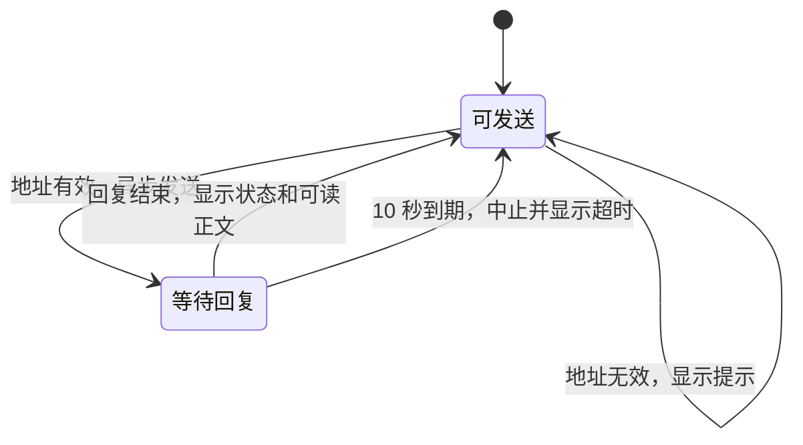

# Qt HTTP Demo 客户端项目设计

## 设计目标

在 Windows 上提供一个 Qt Widgets 客户端，用于输入 HTTP 地址、发送 GET 或 POST，并查看状态码和响应正文。窗口默认指向 `http://127.0.0.1:8080/echo?name=Qt`，配合本机 Node.js 回显服务验证查询参数、UTF-8 中文正文和异常提示。服务端接口见 [通信流程.md](通信流程.md)。

## 工程结构

| 工程或文件 | 职责 |
| --- | --- |
| [QtHttpDemo.sln](QtHttpDemo.sln) | Visual Studio 解决方案，包含客户端项目。 |
| [QtHttpDemo.vcxproj](QtHttpDemo/QtHttpDemo.vcxproj) | 定义编译配置、Qt 依赖、代码生成和调试环境。 |
| [main.cpp](QtHttpDemo/main.cpp) | 创建 `QApplication`，显示 `QtHttpDemo` 窗口并启动事件循环。 |
| [QtHttpDemo.ui](QtHttpDemo/QtHttpDemo.ui) | 定义窗体、输入框、发送按钮、状态标签和只读响应区。 |
| [QtHttpDemo.h](QtHttpDemo/QtHttpDemo.h)、[QtHttpDemo.cpp](QtHttpDemo/QtHttpDemo.cpp) | `QtHttpDemo` 继承 `QMainWindow`，持有生成的 `Ui::QtHttpDemoClass` 和一个 `QNetworkAccessManager`，负责请求与界面联动。 |

窗口的两个按钮共用 `sendRequest(bool isPost)`。窗口类处理输入校验、超时和界面更新，Qt Network 负责连接、收发和 HTTP 协议解析。事件循环派发按钮点击、计时器回调和回复完成信号。类及 API 的逐步解读见 [关键类解析.md](关键类解析.md)。

## 界面与数据设计

| 控件 | 数据与交互 |
| --- | --- |
| `urlEdit` | 读取地址文本，去掉首尾空白，再用 `QUrl::StrictMode` 解析。有效地址须使用 `http` 协议并包含主机。 |
| `bodyEdit` | 提供 POST 正文，初始值为 `{"message":"你好，Qt"}`。发送时把 `QString` 转成 UTF-8 `QByteArray`。 |
| `getButton`、`postButton` | 分别调用 `sendRequest(false)` 和 `sendRequest(true)`。等待响应期间两个按钮同时禁用，完成后恢复。 |
| `statusLabel` | 显示请求中、HTTP 状态码、网络错误或超时。 |
| `responseEdit` | 只读正文区。每次尝试发送时清除旧正文，收到可读响应时显示当前原文。 |

GET 的参数随 URL 查询部分发送，例如 `?name=Qt`。POST 设置 `Content-Type: application/json; charset=utf-8`，将输入框原文作为请求体。发送时读取的 URL 和正文用于本次请求，等待期间编辑输入框会影响下一次发送。

## 请求状态与回复处理

1. `sendRequest()` 校验通过后构造 `QNetworkRequest`，再调用 `QNetworkAccessManager::get()` 或 `post()`。两种方法都返回本次请求的 `QNetworkReply`，窗口通过 `finished` 信号处理结果。
2. `finished` 回调读取 `HttpStatusCodeAttribute`，有值时显示 `HTTP <状态码>`。正文可读时，`readAll()` 取出字节，`QString::fromUtf8()` 解码，最后用 `setPlainText()` 显示原文。
3. HTTP 错误可以同时显示状态码、Qt 错误描述和服务端正文，例如 `404`。连接被拒绝时显示 `errorString()`。发出请求后启动 10 秒定时器，到期时若回复仍在进行，先设置超时标记再调用 `abort()`，由同一个 `finished` 回调显示超时并恢复按钮。
4. 回调结束前调用 `deleteLater()`，把回复对象交给事件循环清理。定时回调以该回复为上下文，回复销毁后自动失效。网络管理器以窗口为父对象，随窗口销毁。

## 构建与验收

- 使用 Visual Studio 2017、MSVC `v141` 和 Qt `5.14.2 msvc2017_64`，支持 **Debug | x64** 和 **Release | x64**。项目默认使用 Windows SDK `10.0.17134.0`，链接 Qt Core、Gui、Widgets 和 Network。
- `QTDIR` 指向 Qt 安装目录，`QtMsBuild` 指向 Qt VS Tools 的构建规则。`uic` 生成界面头文件，`moc` 生成 Qt 元对象代码，生成文件位于 `build/x64/<Configuration>/obj/`，可执行文件位于 `build/x64/<Configuration>/`。
- 验收覆盖 GET 查询参数回显、POST 中文正文回显、404 正文可见、无效地址提示、超时恢复和服务重启后重试。操作见 [使用流程.md](使用流程.md)，实测记录见 [开发测试结果.md](开发测试结果.md)。
