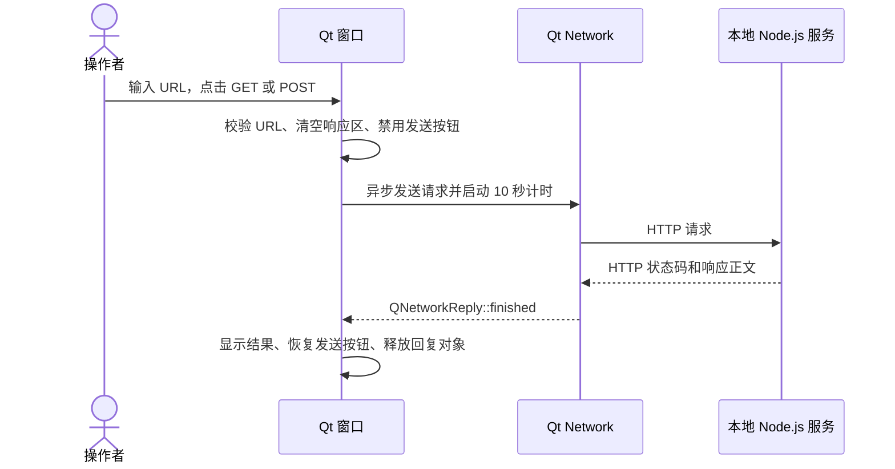

# Qt HTTP Demo 通信流程

Qt Widgets 客户端使用 `QNetworkAccessManager` 发送 HTTP 请求。Node.js 回显服务监听本机 `127.0.0.1:8080`，将收到的查询参数或请求体放进 JSON 响应。请求和响应通过本机 TCP 连接传输。

## 请求和响应时序



URL 必须包含 `http://` 和主机名。输入无效时，窗口直接提示，发送按钮保持可用。正常发起请求后，Qt 事件循环继续运行，窗口在等待期间仍可操作。

## 本地接口

| 请求 | 服务行为 | 正常结果 |
| --- | --- | --- |
| `GET /echo?name=Qt` | 读取查询参数，无需请求体 | `200`，返回 `method: GET` 和 `query.name: Qt` |
| `POST /echo` | 读取 UTF-8 请求体，回显原文及请求的 `Content-Type` | `200`，返回 `method: POST`、`contentType` 和 `body` |
| `GET /slow` | 等待约 12 秒再返回 JSON | 客户端约 10 秒时中止请求并提示超时 |
| `GET /` 或 `GET /missing` | 路径未配置 | `404`，正文包含 `路径不存在` |

### GET 示例

用 `http://127.0.0.1:8080/echo?name=Qt` 发送 GET。`name` 随 URL 一同发送，窗口的 POST 输入框内容不会随 GET 发出。响应正文如下。

```json
{
  "method": "GET",
  "query": {
    "name": "Qt"
  }
}
```

### POST 示例

用 `http://127.0.0.1:8080/echo` 发送 POST，在输入框填入 `{"message":"你好，Qt"}`。Qt 将输入框原文编码为 UTF-8，发出 `Content-Type: application/json; charset=utf-8`。回显服务保留原文，返回的 `body` 是 JSON 字符串，因此字段里的引号会转义。

```json
{
  "method": "POST",
  "contentType": "application/json; charset=utf-8",
  "body": "{\"message\":\"你好，Qt\"}"
}
```

## 状态与异常

| 窗口提示 | 通信停在哪一步 |
| --- | --- |
| `Connection refused` | 到 `127.0.0.1:8080` 的 TCP 连接被拒绝，通常是回显服务未启动或端口填错。此时没有 HTTP 状态码。 |
| `HTTP 404` | 服务已收到 HTTP 请求并返回错误响应。窗口同时保留错误正文，可据此检查 URL 路径。 |
| `请求超时 (10 秒)` | 请求在 10 秒内未结束，客户端调用 `abort()` 中止。两枚按钮恢复，可以改回 `/echo` 重试。 |

实际操作见 [使用流程.md](使用流程.md)。
